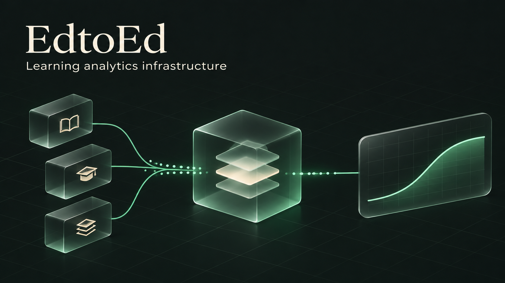
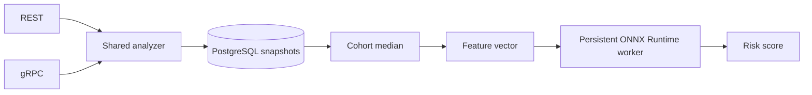

# EdtoEd

**English** · [Русский](README.ru.md)



[](https://github.com/rwrwdss/EdtoEd/actions/workflows/ci.yml)


An LMS-independent analytics backend that turns cohort activity snapshots into academic-risk scores. Integrate through REST or gRPC; inspect the API in Swagger UI.

## What it does

- Stores one aggregate per student, topic, cohort and observation window.
- Computes the real cohort click median, including submitted zero-click students.
- Executes the ONNX model through a persistent CPU ONNX Runtime worker.
- Shares validation and scoring logic across REST and gRPC.
- Provides a reproducible OULAD training pipeline and model evaluation reports.

EdtoEd is a research-stage integration module. The model predicts academic failure/withdrawal; the legacy response field `burnout_risk` does not represent a measured burnout diagnosis.

## Quick start

Requires Docker with Compose.

```sh
git clone https://github.com/rwrwdss/EdtoEd.git
cd EdtoEd/edtoed
docker compose up --build
```

| Interface | Address |
|---|---|
| Swagger UI | [localhost:8080/docs](http://localhost:8080/docs) |
| OpenAPI 3.0 | [localhost:8080/openapi.yaml](http://localhost:8080/openapi.yaml) |
| REST | `POST /v1/analyze` |
| gRPC | `localhost:50051` |
| Probes | `GET /healthz`, `GET /readyz` |

Compose uses development database credentials. Swagger UI loads its assets from a public CDN.

## Send a cohort snapshot

Send cumulative activity for the same completed window, not individual click deltas. The first student is saved with HTTP `409`: scoring needs at least two students and a positive median.

```sh
for student in student-1 student-2; do
  curl -sS http://localhost:8080/v1/analyze \
    -H 'Content-Type: application/json' \
    -d "{\"student_id\":\"$student\",\"topic_id\":\"module-1\",\"cohort_id\":\"orgA-course1-group1\",\"window_start\":1704067200,\"window_end\":1706486400,\"clicks_count\":24,\"test_score\":0.72,\"deadline_delay\":1.5}"
done
```

Repeat a student's request after submitting the full cohort to score against its complete median. Retries replace that student's aggregate. Include students with zero clicks. Cohort IDs should be namespaced by organization; this does not provide authorization or tenant isolation.

See the [aggregate contract](edtoed/COHORT_API.md) for window boundaries, units and retry behavior.

## Architecture



The model is loaded once, with one CPU compute thread. Requests are serialized per worker. Invalid model files fail startup; worker failure currently requires a service restart.

## Model and evidence

Input: `float_input`, float32 `[N,3]`, ordered as `relative_clicks`, `test_score`, `deadline_delay`. Output: `probabilities`, with integer key `1` for academic risk. Other models must preserve this contract or use a new adapter.

Training uses OULAD course days 0–28 inclusive, a zero-inclusive cohort median and signed deadline delays. Train: 2013; validation: 2014B; test: 2014J, excluding repeated students across splits.

| Test metric | Threshold 0.5 | Service threshold 0.7 |
|---|---:|---:|
| ROC-AUC | 0.694 | 0.694 |
| Precision | 0.507 | 0.697 |
| Recall | 0.661 | 0.281 |
| F1 | 0.574 | 0.401 |
| Accuracy | 0.624 | 0.677 |

Test set: 7,929 enrollments. Compared with the prior model on identical inputs, recall improved while accuracy and Brier score worsened. OULAD has already been explored; these results are not independent external validation. Arbitrary LMS windows are accepted by the API, but model accuracy outside the training domain is unverified.

[Evaluation report](edtoed/ml_research/artifacts/oulad_baseline_report.md) · [Training guide](edtoed/ml_research/README.md)

## Configuration

| Variable | Default / requirement |
|---|---|
| `DATABASE_URL` | Required PostgreSQL DSN |
| `MODEL_PATH` | `models/edtoed_v1.onnx` |
| `PYTHON_BIN` | `python3`; may point to a virtual environment |
| `HTTP_ADDR` | `:8080` |
| `GRPC_ADDR` | `:50051` |

## Development

Run from `edtoed/` with Go and Python installed:

```sh
python3 -m pip install onnxruntime==1.22.1 numpy==2.2.6 pandas==2.2.3 onnx==1.18.0
TEST_ONNX=1 go test -race ./...
go vet ./...
cd ml_research
python3 -m unittest test_training -v
```

Set `TEST_DATABASE_URL` to a disposable PostgreSQL database to enable storage integration tests. CI runs formatting, Go checks, real ONNX tests, training protocol tests, PostgreSQL integration and Docker build.

## Repository

| Path | Contents |
|---|---|
| `edtoed/api/proto/` | gRPC contract and generated bindings |
| `edtoed/internal/` | HTTP, service, feature, runtime and storage layers |
| `edtoed/models/` | One active serving model |
| `edtoed/ml_research/` | Training code, research candidate and reports |
| `.github/workflows/` | CI |

Next priorities: external validation, calibrated probabilities and intervention thresholds, authentication and tenant isolation, worker recovery, telemetry and load testing. Readiness currently checks configured components, not live dependency health.

Dataset attribution: Kuzilek, Hlosta and Zdrahal, [OULAD](https://doi.org/10.24432/C5KK69), CC BY 4.0. This dataset license does not imply a license for the repository code.
