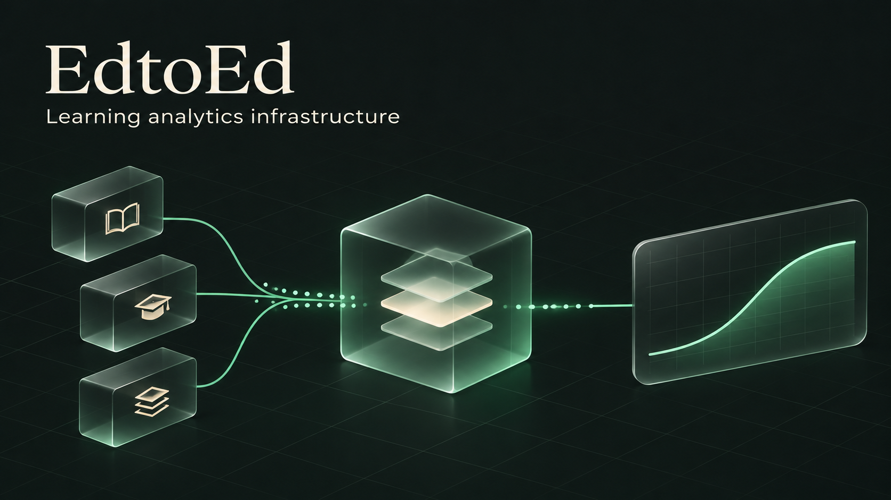
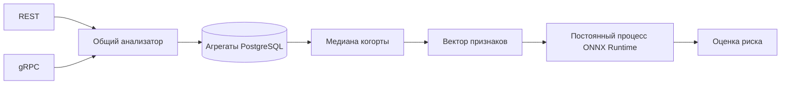

# EdtoEd

[English](README.md) · **Русский**



[](https://github.com/rwrwdss/EdtoEd/actions/workflows/ci.yml)


Независимый от конкретной LMS backend-модуль: преобразует агрегаты учебной активности когорты в оценки академического риска. Подключение через REST или gRPC, интерактивная документация — Swagger UI.

## Возможности

- Один агрегат на студента, тему, когорту и окно наблюдения.
- Реальная медиана кликов, включая переданных студентов с нулевой активностью.
- Исполнение ONNX через постоянный CPU-процесс ONNX Runtime.
- Общая логика валидации и прогнозирования для REST и gRPC.
- Воспроизводимое обучение на OULAD и отчёты с метриками.

Проект находится на исследовательском этапе. Модель прогнозирует неуспешное завершение курса или уход; историческое поле ответа `burnout_risk` не является измерением или диагнозом выгорания.

## Быстрый старт

Нужен Docker с Compose.

```sh
git clone https://github.com/rwrwdss/EdtoEd.git
cd EdtoEd/edtoed
docker compose up --build
```

| Интерфейс | Адрес |
|---|---|
| Swagger UI | [localhost:8080/docs](http://localhost:8080/docs) |
| OpenAPI 3.0 | [localhost:8080/openapi.yaml](http://localhost:8080/openapi.yaml) |
| REST | `POST /v1/analyze` |
| gRPC | `localhost:50051` |
| Проверки состояния | `GET /healthz`, `GET /readyz` |

В Compose используются пароли для разработки. Swagger UI загружает оформление и скрипты с публичного CDN.

## Передача агрегатов когорты

Передавайте накопленную активность за одинаковое завершённое окно, а не отдельные приращения кликов. Первый студент сохраняется с HTTP `409`: для расчёта нужны минимум два студента и положительная медиана.

```sh
for student in student-1 student-2; do
  curl -sS http://localhost:8080/v1/analyze \
    -H 'Content-Type: application/json' \
    -d "{\"student_id\":\"$student\",\"topic_id\":\"module-1\",\"cohort_id\":\"orgA-course1-group1\",\"window_start\":1704067200,\"window_end\":1706486400,\"clicks_count\":24,\"test_score\":0.72,\"deadline_delay\":1.5}"
done
```

После передачи всей когорты повторите запрос студента, чтобы получить прогноз по полной медиане. Повторная отправка заменяет его агрегат. Обязательно передавайте студентов с нулевыми кликами. Добавляйте организацию в идентификатор когорты; это соглашение об именовании не заменяет авторизацию и изоляцию организаций.

Границы окна, единицы измерения и повторные запросы описаны в [контракте агрегатов](edtoed/COHORT_API.md).

## Архитектура



Модель загружается один раз, вычисления ограничены одним CPU-потоком. Запросы внутри worker обрабатываются последовательно. Некорректная модель блокирует запуск; при отказе worker пока требуется перезапуск сервиса.

## Модель и результаты

Вход: `float_input`, float32 `[N,3]`, порядок: `relative_clicks`, `test_score`, `deadline_delay`. Выход: `probabilities`, целочисленный ключ `1` — академический риск. Другие модели должны сохранять этот контракт либо использовать новый адаптер.

Обучение использует дни курса 0–28 включительно, медиану с нулевыми кликами и задержку со знаком. Train: 2013; validation: 2014B; test: 2014J. Повторные студенты между выборками исключены.

| Метрика на тесте | Порог 0.5 | Порог сервиса 0.7 |
|---|---:|---:|
| ROC-AUC | 0.694 | 0.694 |
| Precision | 0.507 | 0.697 |
| Recall | 0.661 | 0.281 |
| F1 | 0.574 | 0.401 |
| Accuracy | 0.624 | 0.677 |

Тестовая выборка: 7 929 зачислений. На одинаковых признаках новая модель повысила recall, но ухудшила accuracy и Brier относительно предыдущей. OULAD уже исследовался, поэтому это не независимая внешняя проверка. API принимает произвольные окна LMS, но точность вне области обучения не подтверждена.

[Отчёт с метриками](edtoed/ml_research/artifacts/oulad_baseline_report.md) · [Руководство по обучению](edtoed/ml_research/README.md)

## Конфигурация

| Переменная | Значение по умолчанию / требование |
|---|---|
| `DATABASE_URL` | Обязательный PostgreSQL DSN |
| `MODEL_PATH` | `models/edtoed_v1.onnx` |
| `PYTHON_BIN` | `python3`; можно указать интерпретатор виртуального окружения |
| `HTTP_ADDR` | `:8080` |
| `GRPC_ADDR` | `:50051` |

## Разработка

Запускайте из `edtoed/`; нужны Go и Python:

```sh
python3 -m pip install onnxruntime==1.22.1 numpy==2.2.6 pandas==2.2.3 onnx==1.18.0
TEST_ONNX=1 go test -race ./...
go vet ./...
cd ml_research
python3 -m unittest test_training -v
```

Укажите `TEST_DATABASE_URL` с адресом отдельной тестовой PostgreSQL для интеграционных тестов хранилища. CI проверяет форматирование, Go-код, реальный ONNX-инференс, протокол обучения, PostgreSQL и сборку Docker.

## Структура репозитория

| Путь | Содержимое |
|---|---|
| `edtoed/api/proto/` | gRPC-контракт и сгенерированный код |
| `edtoed/internal/` | HTTP, сервис, признаки, runtime и хранилище |
| `edtoed/models/` | Одна действующая модель сервиса |
| `edtoed/ml_research/` | Обучение, исследовательский кандидат и отчёты |
| `.github/workflows/` | CI |

Далее: внешняя проверка качества, калибровка вероятностей и порога вмешательства, авторизация и изоляция организаций, восстановление worker, телеметрия и нагрузочные тесты. Сейчас readiness проверяет наличие компонентов, а не фактическое здоровье зависимостей.

Источник данных: Kuzilek, Hlosta и Zdrahal, [OULAD](https://doi.org/10.24432/C5KK69), CC BY 4.0. Лицензия датасета не означает такую же лицензию кода репозитория.
